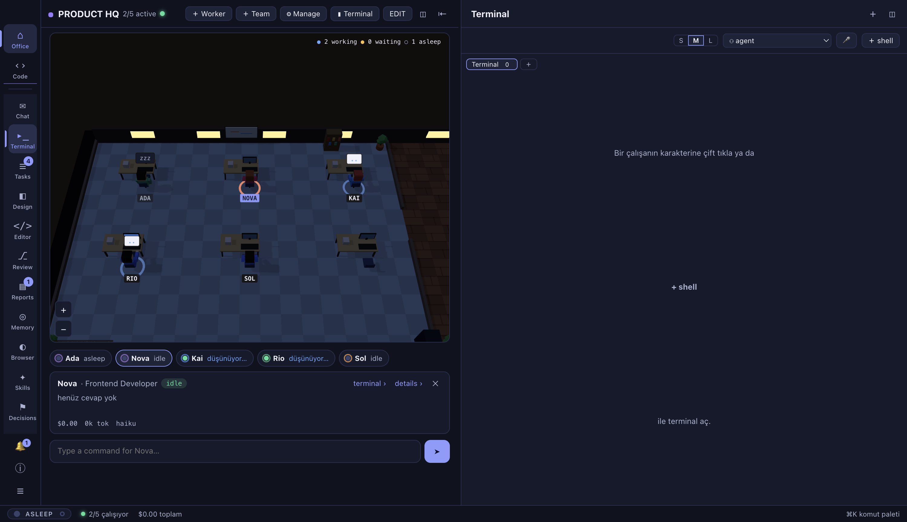
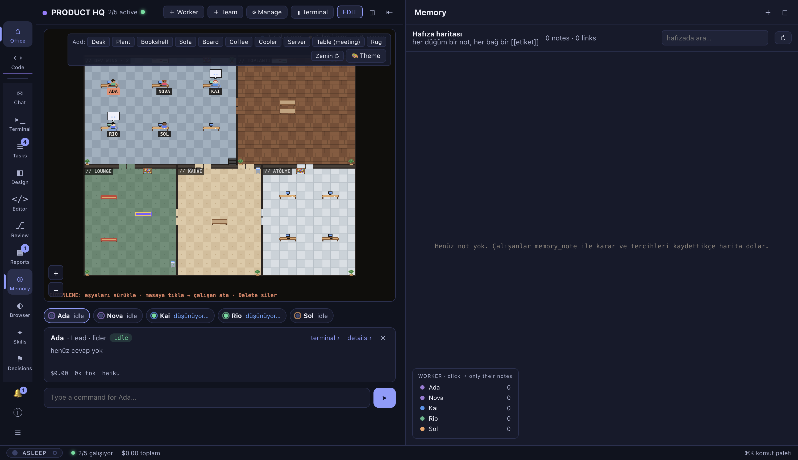
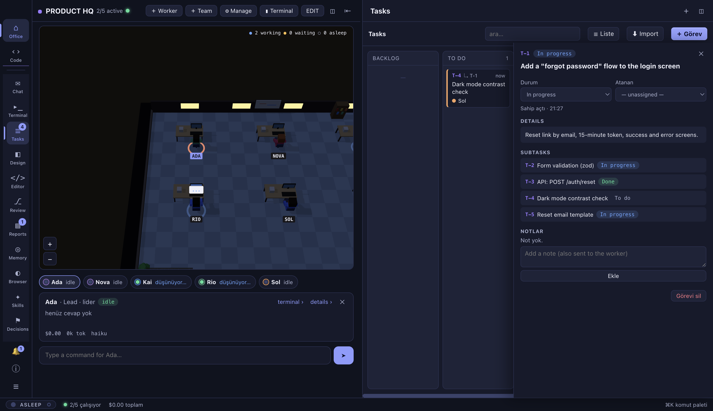
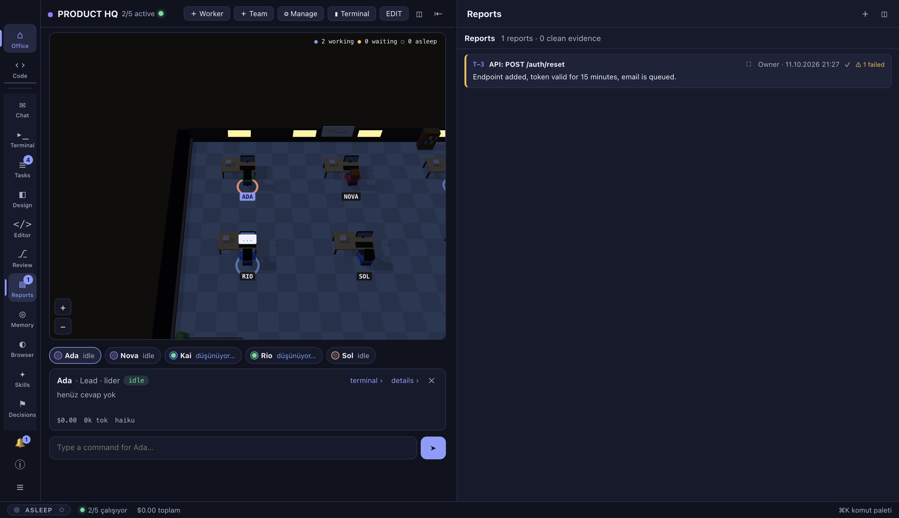
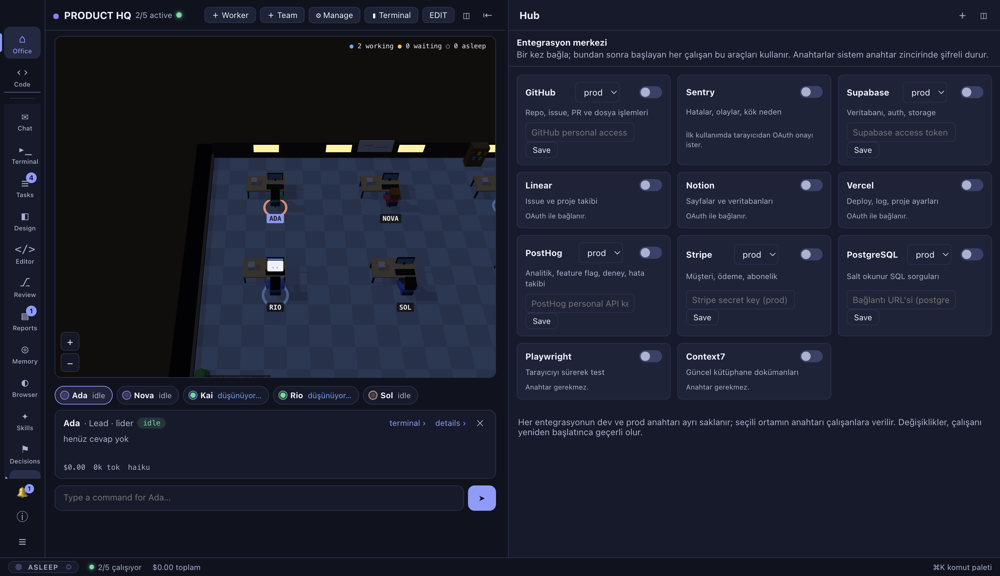

<h1 align="center">Agent Office</h1>

<p align="center">
  <b>Run a team of AI agents from a pixel-art office on your desktop.</b><br>
  Every teammate is a real <a href="https://claude.com/claude-code">Claude Code</a> session in its own terminal.<br>
  You set the goal, the lead splits it up, the team works, and every task closes with proof.
</p>

<p align="center">
  
</p>

## What it is

Agent Office is an Electron app that turns Claude Code sessions into a small company. You see who is working, who is waiting for you and who is asleep. You hand the lead a goal in plain language and watch the board fill up. Nobody gets to say "done" without showing evidence.

## Features

### A living office

Rooms, desks and named teammates. A teammate glows blue while working, calls you with a **!** when it needs you, sits with a **z z** when asleep and wanders to the lounge when idle. Click a character for its latest answer and a command box; double-click to open its terminal.

<p align="center">
  
</p>

Hit **EDIT** to drag furniture, assign desks and change floors. Layouts are yours to design.

### A task board that agents actually use

Backlog → To do → In progress → Review → Done. A goal you add goes to the lead, who breaks it into subtasks with `task_create` and hands them out. An assigned card lands in the teammate's terminal and wakes it up if it was asleep. Subtasks, notes, a list view and drag-and-drop are all there.

<p align="center">
  
</p>

### Reports with evidence

A task can only be closed with `task_done`: a summary, the checks that were run (typecheck, build, tests, a manual check) with pass/fail, and the files changed. No evidence, no done. Failed checks are flagged so you see them first.

<p align="center">
  
</p>

### Hub: connect once, every agent gets it

GitHub, Sentry, Supabase, Linear, Notion, Vercel, PostHog, Stripe, PostgreSQL, Playwright and Context7. Connect a service once; every teammate started afterwards can use it as an MCP tool. Dev and prod keys are stored separately and encrypted in your system keychain.

<p align="center">
  
</p>

### And more

- **Terminal panes** – every teammate and shell runs in a real pty (node-pty + xterm). Split, resize, drag to rearrange, layouts are remembered. Each pane header shows model, branch and a **usage meter** (total $ and tokens).
- **Teams** – add one worker or a whole team from a template (software, marketing, research, product). Role, brief, model and permission mode per worker. Identity is persistent: sessions and memory files survive a restart.
- **Hands-off mode** – when on, an idle worker picks up the next open card by itself.
- **Shared memory** – workers save decisions and preferences with `memory_note` and search the team's memory with `memory_search`. The Memory tab draws notes and `[[tag]]` links as a map.
- **Team chat** – talk to the whole team (the lead takes it) or to one person with `@name`.
- **Design tab** – an agent drafts a screen mock-up before any code; drop numbered notes on it and send them back.
- **Code editor and review** – open project files or a worker's branch, edit with syntax colours, send a selection with a comment to a worker, compare branches file by file, commit, merge or open a PR.
- **In-app browser** – a webview (localhost included) where you can annotate a page and send a numbered screenshot to a worker.
- **Themes and languages** – six themes (Night, Deep, Charcoal, Phosphor, Paper, Day), English and Turkish.

## Getting started

Requirements: Node.js, and the `claude` CLI (Claude Code v2.1.224 or newer) installed and signed in.

```bash
git clone https://github.com/melihdikmen/agent-office.git
cd agent-office
npm install      # node-pty is compiled for Electron (needs Xcode Command Line Tools on macOS)
npm start        # builds and opens the app
```

Other scripts:

```bash
npm run check        # syntax check + build + tests
npm run shot         # builds a demo office and saves screenshots to out/shots/
npm run dist:mac     # package for macOS (also dist:win, dist:linux, dist:all)
```

## How it works

- Starting a worker means running `claude --name <name> --model … --permission-mode … --append-system-prompt <briefing> --mcp-config <office>` in a pty. The briefing tells it who it is, who its team is, the board rules and where its memory file lives.
- The app runs a local **MCP server** (`src/main/mcp.js`). Each worker connects through its own tokened address and gets `board_list`, `task_create`, `task_update`, `task_done`, `message`, `memory_note`, `memory_search` and `team_list`. The board, reports and memory all run through these tools.
- Status (working / idle / waiting for you) is read from Claude Code's own session registry in `~/.claude/sessions`; the last answer and cost come from the session transcript.
- Your commands and board notifications are typed into the worker's terminal and queued until Claude is ready.
- Data lives in your app data folder: offices, workers, cards and reports in `office.json`, memory files under `workspaces/<office>/memory/`. Your code, terminal output and session transcripts stay on your disk.

## Good to know

- Every worker is a separate Claude session. A talkative team of four or five uses far more tokens than a single session; the usage meter in each pane header shows the real cost.
- The default permission mode is **auto**. Some commands still ask for approval; the worker then shows a **!** in the office and you answer in its terminal. A "never ask" mode exists and is risky.
- The format of `~/.claude/sessions` and the transcripts is internal to Claude Code. If it changes, status indicators get coarser; the workflow keeps working.
- The packages and addresses in the Hub are the services' official MCP servers; ones that need OAuth open your browser on first use.
- Some interface strings are still Turkish when the language is set to English; translations are being filled in.

## Development

- `AGENT_OFFICE_DATA=/dir` uses a separate data folder.
- `scripts/shot.js` opens the app in an invisible window and takes screenshots (`SHOT_ONLY=office,board` for chosen views, `SHOT_WAIT=60000` to give the lead time to split tasks).
- `scripts/shot-readme.js` produces the English screenshots in `docs/img/` used by this README.
- Design notes for the office look and motion live in [`docs/design-agentspace.md`](docs/design-agentspace.md).

## License

MIT
